# Flownics

An Android training app built around one idea: you plan, train and look back in one place, with
a coach that can read your training and propose changes, and every change waits for your
approval.

You build your own exercise library and workouts, and run them with a timer that fills the rests
with stretches or mobility work. Runs and rides come in from a Garmin watch with every lap and
heart-rate reading. A coach (an AI agent using your own API key) reads all of it, plans your
week, and proposes changes. Nothing changes until you accept it.

Kotlin · Jetpack Compose · Material 3 · Hilt · Room · Coroutines/Flow · kotlinx.serialization ·
WorkManager · Hebrew and English with full right-to-left support.

## Screenshots

<p align="center">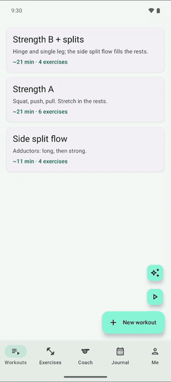</p>

| Exercise library | Exercise page | Progress |
|:-:|:-:|:-:|
| 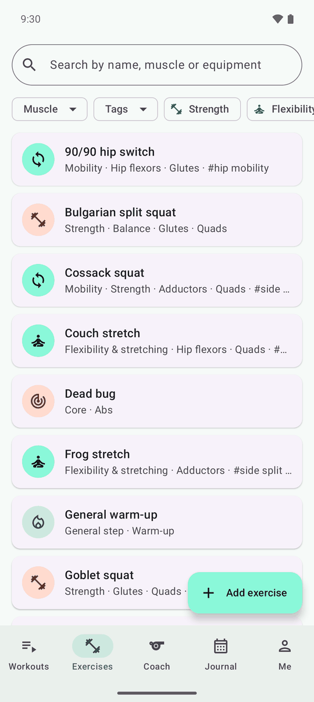 | 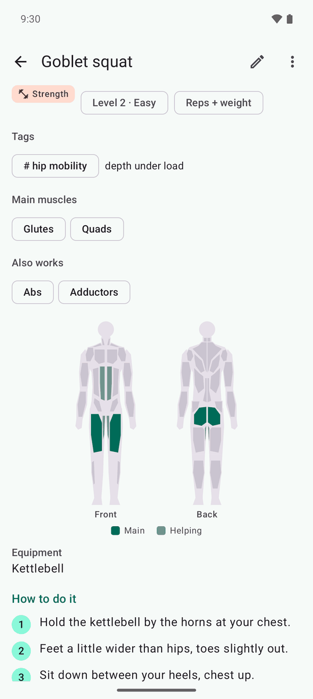 | 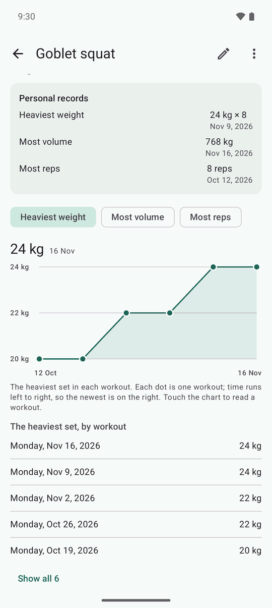 |
| **A workout** | **Building it** | **Player: active rest** |
| 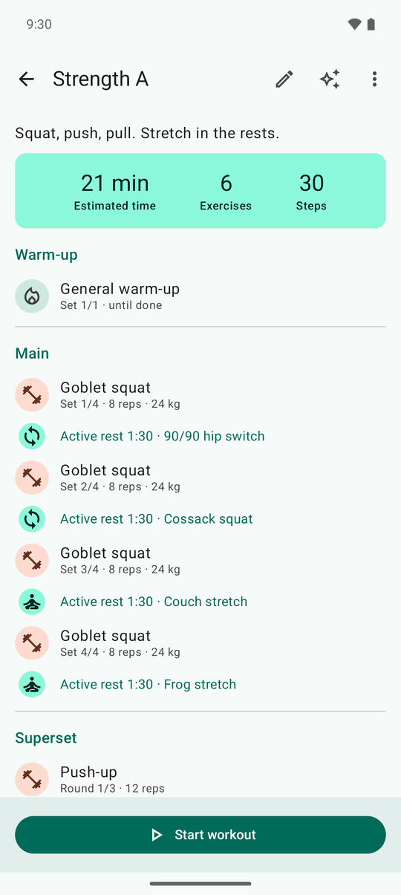 | 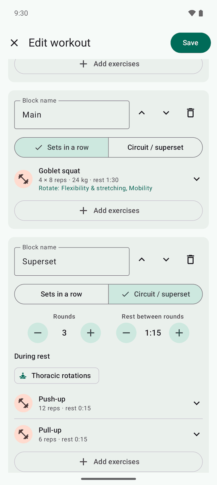 | 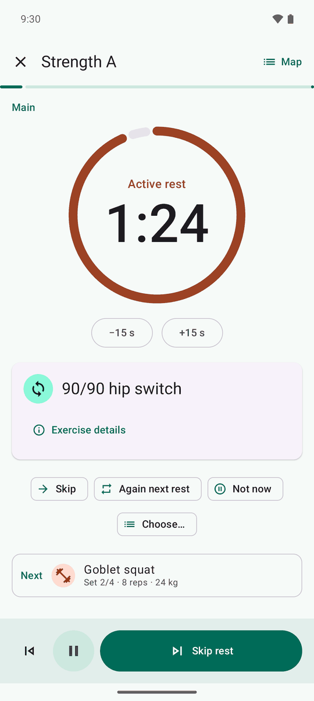 |
| **Journal week** | **Planned and done** | **A run's structure** |
| 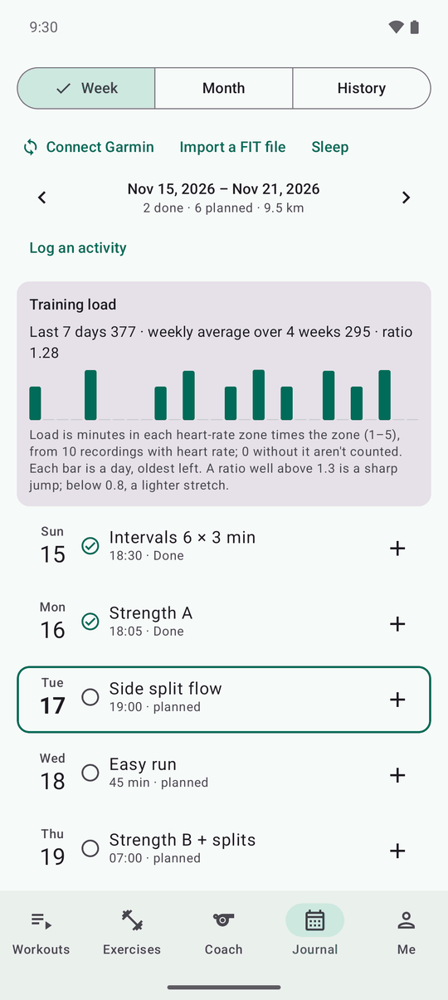 | 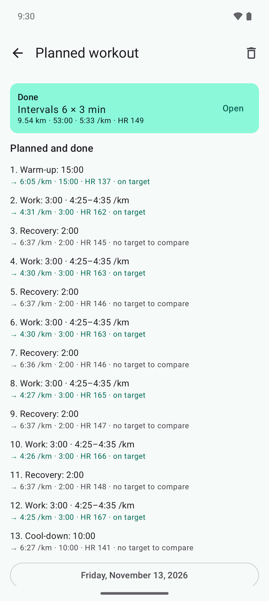 | 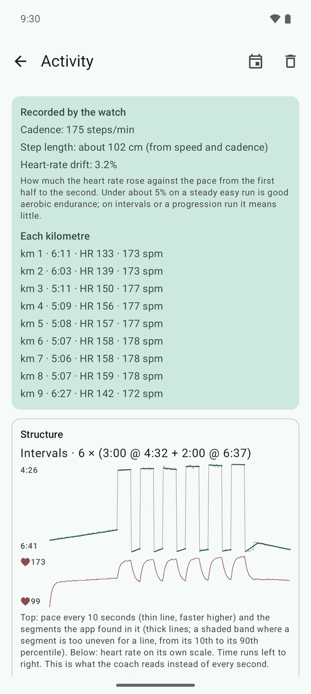 |
| **My data** | **Sleep and recovery** | **Coach** |
| 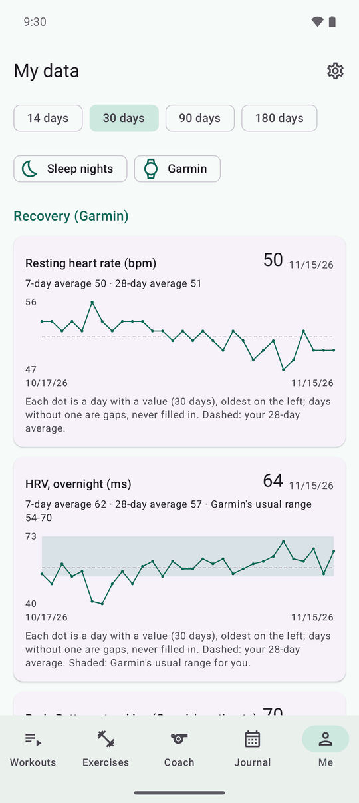 | 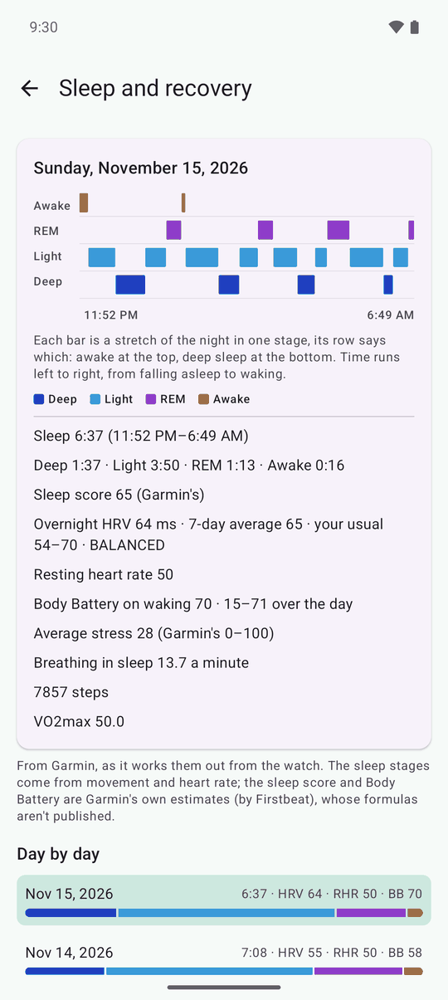 | 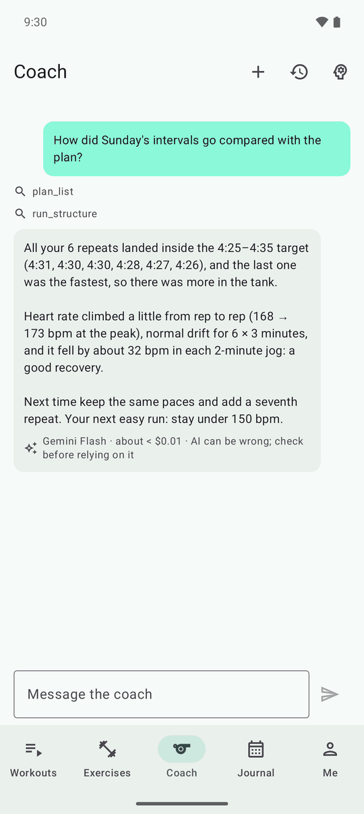 |

In Hebrew, right to left:

| | | |
|:-:|:-:|:-:|
| 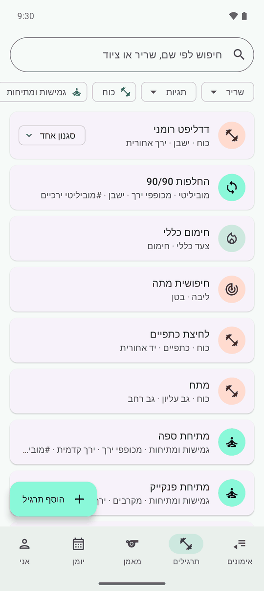 | 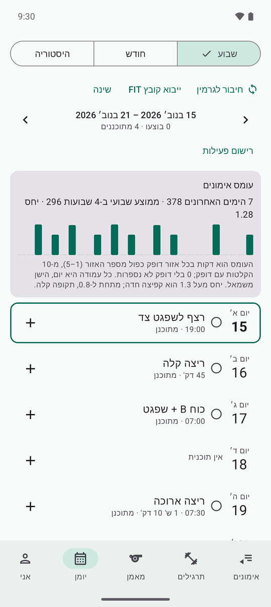 | 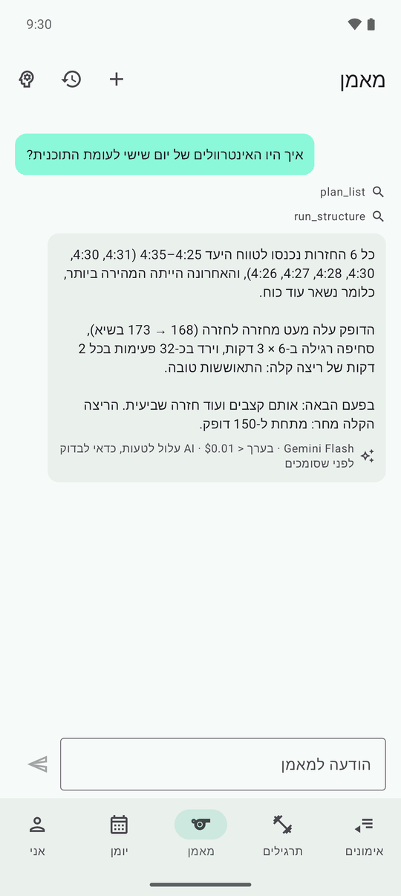 |

All names, workouts, runs, sleep and heart-rate data in these pictures are made up (see
[Demo data](#demo-data)); the coach's answer was written from the demo run's numbers, not by a
model.

## What it does

**Library and workouts**
- Exercises with several kinds at once (say, strength and balance), primary and secondary
  muscles, instructions, cues, stages, photos and videos. Styles of one exercise are grouped in a
  family (a rope, band or single-arm face pull) under one default.
- Free **tags** of your own (a goal like "side split"), each with what the exercise does for
  it, and a page per tag. **General steps** ("general warm-up") that need no specific exercise.
- A workout builder with blocks, supersets and circuits, rests, and **active rest**: a stretch or
  a rotating pool of mobility exercises in the rests.
- **Two workouts as one.** A stretching routine can fill the rests of a strength workout, one
  exercise per rest in its own order, with the rest done at the end.

**The player**
- A step-by-step player built on a pure state machine. Timers are worked out from monotonic
  timestamps, so they stay right when the screen is off, after rotation, and after the process is
  killed.
- A foreground service with lock-screen controls, Hebrew text-to-speech, sounds and vibration.
- **Live heart rate over Bluetooth** from a chest strap, or a Garmin watch broadcasting its heart
  rate, kept with the workout set by set.

**Journal, plan and calendar**
- A week and month journal of what was planned and what was done.
- Planned runs with parts and pace or heart-rate targets, then compared part by part with what
  was run.
- Opt-in sync to a Google calendar. It touches only events it created itself.
- Reminders before planned workouts.

**Garmin and FIT**
- A **FIT decoder written for this app** from the published protocol. It handles definitions,
  compressed timestamps and developer fields, and was tested on real recordings from several
  devices.
- Laps become the parts of an activity. Kilometre splits, cadence, step length, ground contact
  and heart-rate drift are computed from the per-second samples.
- Optional sync with the user's own Garmin *personal* API key: in the background, read-only.
- A watch recording made during an app workout **joins that workout**. You get one entry, with
  heart rate set by set and a chart.
- Heart-rate zones (Karvonen) and training load (Edwards TRIMP) over 7 against 28 days.
- **Sleep and recovery** from the same key: sleep stages, overnight HRV, resting heart rate,
  Body Battery, stress, steps, VO2max. Garmin's answers are kept as they came, so a better
  reader rebuilds every day, and a data explorer shows them raw. A "My data" screen charts each
  metric against the user's own averages.
- **Runs compressed into their structure**, deterministically, for the coach and the run screen.
  The samples go into 5-second bins, with grade-adjusted pace (Minetti 2002). Change points come
  from PELT, with one continuous piecewise-linear line: a bend where the pace bends, a jump only
  where the data jumps. Heart rate is fitted as first-order kinetics from where it was. From
  these come the levels, the repeats rep by rep, and the run's type.

**The coach (AI agent)**
- A provider-neutral tool loop over Gemini and Claude:
  - Streamed answers, and a stall watchdog instead of a fixed timeout.
  - Gemini: the model's thought signatures are passed back exactly as received.
  - Claude: strict client tools.
- Read tools give it the user's data: sets one by one (never averaged), interval parts, splits,
  heart rate, the plan and the library.
- Write tools only ever produce **proposal cards** the user accepts row by row: workouts,
  exercise edits, activities to log, plan changes.
- A memory it keeps by itself. It is visible, and each note can be undone.
- Every call is logged with its cost, under a monthly spending cap.

**Sharing and backup**
- A versioned zip format with a strict reader: no zip-slip, size limits, and types checked by
  their magic bytes.
- Merge-import from a friend's file, and full restore.
- Automatic backup to a folder you choose.

## Design choices

- **No server, no accounts.** Data stays on the phone. AI and Garmin use *your* keys, encrypted
  with the Android Keystore and kept out of backups. No key ships with the app.
- **AI proposes, you decide.** Model output is checked against the app's own lists. User content
  and web results are treated as data, never as instructions (a guard against prompt
  injection). Sources shown are only those the search actually returned.
- **Failures are visible.** Nothing is silently patched over: a refused key, a stalled stream or
  an unreadable file each says what happened.
- **Pure domain logic, unit-tested.** The workout compiler, player, FIT decoder, plan matching,
  heart-rate zones and load, proposal parsing and the bundle format are plain Kotlin, with
  around 140 unit tests.
- **Schema migrations are real**: v1 to v12, each one written by hand and checked against
  Room's exported schemas.

## Project layout

```
app/src/main/java/com/yonizilber/flownics/
  domain/     pure Kotlin: models, workout compiler, player, FIT, plan, coach formatting
  data/       Room, repositories, AI clients, Garmin, coach agent, transfer (backup/share)
  feature/    one package per screen: Compose UI + ViewModel
  calendar/   calendar sync and reminders
  sensors/    Bluetooth heart rate
  player/     the workout player service
```

How it was built, phase by phase: [docs/HISTORY.md](docs/HISTORY.md).

## Installing

Flownics is not on Google Play. To try it on an Android phone (Android 8 or newer):

1. Open the [Releases](https://github.com/yonizilber/Flownics/releases) page on the phone and
   download the latest `.apk`.
2. Open it. Android asks to allow your browser (or file manager) to install apps; allow it for
   this once.
3. Updates install the same way, over the app already there; your data stays.

Everything you enter stays on your phone. The AI coach and helpers need your own Gemini or Claude
API key (entered in the app, stored encrypted on the phone); the app works without one. Garmin
sync is optional too. Me > Settings > Backup and sharing saves everything to a file, for a new phone.

## Building

Open the project in Android Studio and run `app` (minSdk 26, targetSdk 36), or from the command
line:

```
./gradlew assembleDebug testDebugUnitTest
```

The AI features need your own Gemini or Claude API key, entered in the app. Garmin sync is
optional and needs a personal API key from Garmin Connect. Importing `.fit` files needs neither.

### Demo data

Debug builds include a demo-data seeder for screenshots (`app/src/debug/.../demo`). It fills an
**empty** app with made-up data: a library with tags and families, three workouts, six weeks of
sessions, runs written as FIT files and imported through the app's own importer, a week of plans,
six months of watch data and a coach conversation. Only adb can trigger it (the receiver needs
the `DUMP` permission, which the shell has and apps don't), and it refuses an app that already has
exercises. It also stores a placeholder Gemini key (`DEMO-NOT-A-REAL-KEY`) so the coach screen
shows its message box; any call made with it fails. It is not in release builds.

```
adb shell am broadcast -a com.yonizilber.flownics.DEMO_SEED -p com.yonizilber.flownics
# Hebrew names: add  --ez hebrew true
```

## Disclaimer

Flownics gives training information, not medical advice. Consult a doctor before starting a new
exercise programme.

## License

Apache License 2.0. See [LICENSE](LICENSE). The sample FIT files used by the unit tests come from
[python-fitparse](https://github.com/dtcooper/python-fitparse) (MIT); see
`app/src/test/resources/fit/`.
